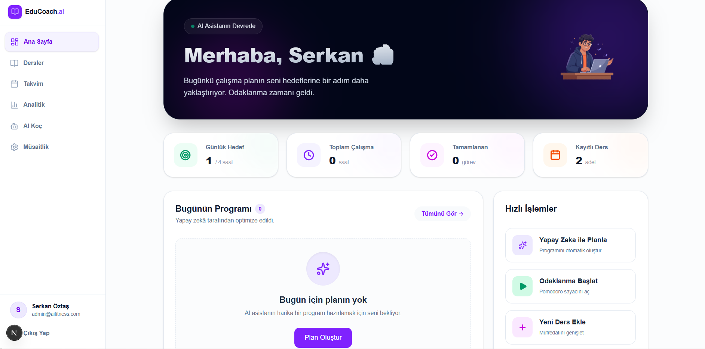
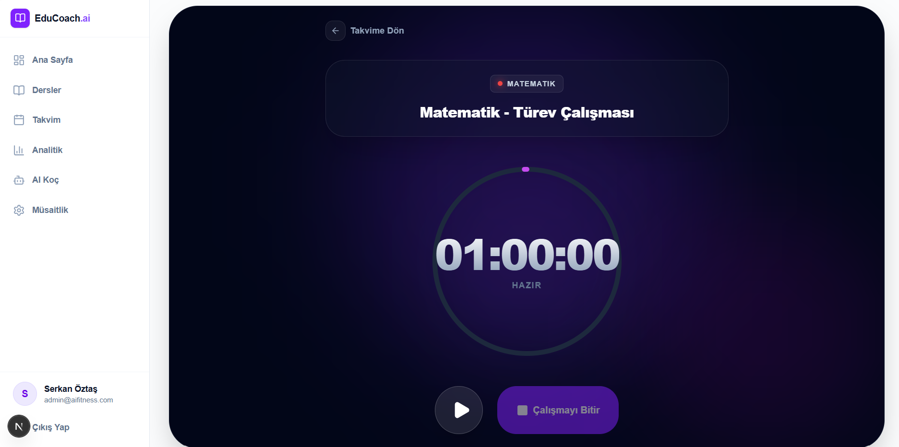
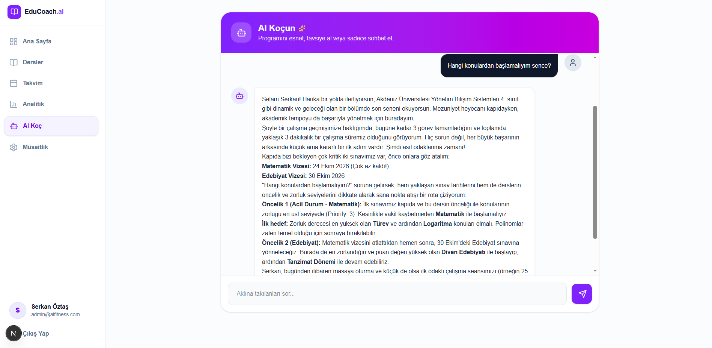
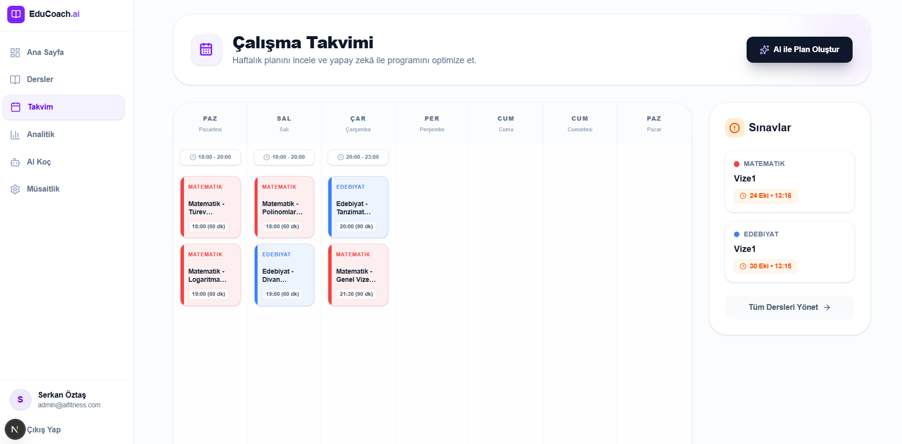

# 🧠 EduCoach - AI Study Planner



EduCoach is a modern, AI-powered study planner and academic tracker built for students who want to optimize their productivity. Featuring a premium **Bento Grid** layout, **Glassmorphism** aesthetics, and **Framer Motion** animations, EduCoach brings a next-generation SaaS experience to personal study management.

---

## ✨ Key Features

### 🤖 AI-Powered Study Planning (Gemini AI)
Stop worrying about what to study and when. Input your availability and upcoming exams, and let Google Gemini AI generate an optimized, realistic, and balanced weekly study schedule for you.


### 🍅 Focus Mode (Pomodoro Timer)
A dedicated, distraction-free environment to complete your tasks. Features a beautiful SVG progress ring, dynamic aurora backgrounds, and direct database synchronization upon completion.



### 💬 AI Study Assistant (Chatbot)
Engage with a built-in AI chatbot tailored for your academic needs. Ask questions, get motivation, and receive instant, personalized coaching to overcome study blocks directly from your dashboard.



### 📅 Interactive Study Calendar
Visualize your academic week through an Apple Calendar-inspired interface. Manage availability slots, view AI-assigned tasks, and stay on top of upcoming exams with beautifully crafted event cards and seamless navigation.



---

## 🛠️ Tech Stack

- **Framework:** [Next.js 15](https://nextjs.org/) (App Router)
- **Styling:** [Tailwind CSS](https://tailwindcss.com/) & [Framer Motion](https://www.framer.com/motion/) (21st.dev UI Standards)
- **Database:** [PostgreSQL](https://www.postgresql.org/)
- **ORM:** [Prisma](https://www.prisma.io/)
- **Authentication:** [NextAuth.js](https://next-auth.js.org/)
- **AI Integration:** [Google Gemini API](https://ai.google.dev/)

---

## 🚀 Getting Started

Follow these steps to run EduCoach locally on your machine.

### 1. Clone the repository
```bash
git clone [https://github.com/serkanoztas/ai-study-planner.git](https://github.com/serkanoztas/ai-study-planner.git)
cd ai-study-planner

```bash
npm install
```

### 2. Configure environment variables

Create a `.env` file in the root directory and add the environment variables required by the application.

```env
DATABASE_URL="your_postgresql_connection_string"
AUTH_SECRET="your_auth_secret"
GEMINI_API_KEY="your_gemini_api_key"
```

> **Note:** Replace the placeholder values with your actual credentials. Check your authentication configuration and environment variable names in the source code before running the application. Never commit your `.env` file or expose API keys in your repository.

### 3. Set up the database

Generate the Prisma Client and apply your database schema:

```bash
npx prisma generate
npx prisma db push
```

Make sure your PostgreSQL server is running and the `DATABASE_URL` points to a valid database.

### 4. Start the development server

```bash
npm run dev
```

Open [http://localhost:3000](http://localhost:3000) in your browser to access EduCoach.

---

## 📖 How It Works

1. **Sign In:** Authenticate and access your personal study dashboard.
2. **Organize Your Studies:** Create subjects, add topics, and manage upcoming exams.
3. **Generate a Study Plan:** Provide your availability and academic priorities to receive an AI-generated weekly schedule.
4. **Stay Focused:** Use the Pomodoro timer to manage study sessions and record completed work.
5. **Track Your Progress:** Review your study statistics and receive AI-powered insights to improve your study habits.

---

## 🏗️ Architecture & Implementation

EduCoach combines a modern Next.js application with a relational database and AI-powered features.

- **Frontend:** A responsive dashboard built with Next.js, Tailwind CSS, and reusable UI components.
- **Data Layer:** PostgreSQL stores application data, while Prisma provides type-safe database access.
- **Authentication:** NextAuth.js manages user authentication and protected application routes.
- **AI Services:** Google Gemini API generates personalized study schedules and performance-based recommendations.
- **Study Tracking:** Study sessions and academic progress are used to present analytics and help users monitor their productivity.

---

## 🔒 Security & Privacy

- Keep API keys and authentication secrets in environment variables.
- Never commit `.env` files or other sensitive credentials.
- Use authenticated server-side operations to protect user-specific data.
- Configure production environment variables separately from local development settings.

---

## 🗺️ Future Improvements

Potential areas for further development include:

- [ ] More personalized AI recommendations based on long-term study patterns.
- [ ] Enhanced exam preparation tools and topic-level progress tracking.
- [ ] Additional analytics and productivity reports.
- [ ] Improved study schedule adjustments based on completed and missed sessions.

---

## 👨‍💻 Author

**Serkan Öztaş**
- LinkedIn: (linkedin.com/in/serkanoztas)
- GitHub: [@serkanoztas](https://github.com/serkanoztas)
- Project Repository: [ai-study-planner](https://github.com/serkanoztas/ai-study-planner)

---

## 📄 License

This project is available as an open-source project. A license has not yet been specified. Add a `LICENSE` file to clarify the terms under which others may use, modify, and distribute the code.
```
